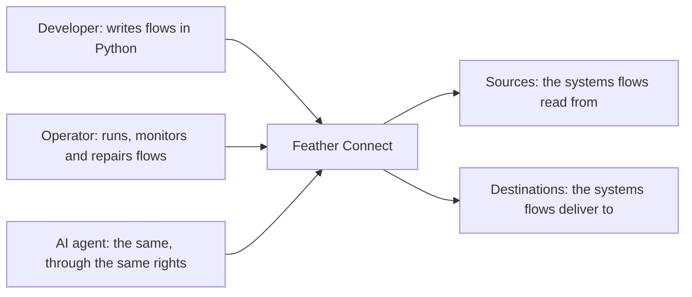
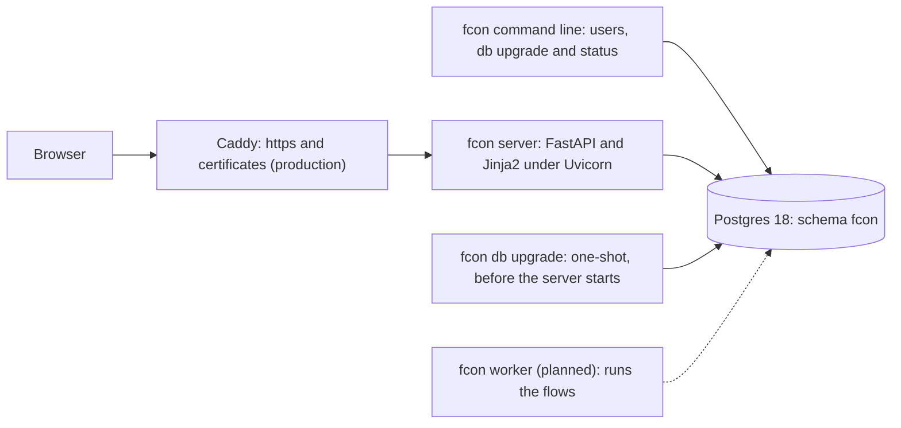

# Architecture

The whole system on one page, for a developer new to it. Any change that adds or removes a
service, a store or an outside system updates this page (`change-modes` § Definition of Done).
The diagrams follow the `c4-diagrams` skill. The reasons for each choice are in [`adr/`](../adr/).

## Context: who and what it talks to

Sources and destinations arrive with the first connectors; each has a fake and a contract test
(#28).

## Containers: what runs, and where data lives

| Container | What it does | Talks to |
|---|---|---|
| `fcon server` | The dashboard: signed-in pages rendered on the server, `/healthz` and `/readyz` | Postgres |
| `fcon` command line | Adding and managing users, upgrading the database, starting the server | Postgres |
| `fcon db upgrade` | Applies the database's waiting upgrades, under a lock, before the server starts | Postgres |
| Postgres 18 | Every table in the schema `fcon`, each keyed by tenant | — |
| Caddy | In production only: https with automatic certificates, in front of the server | `fcon server` |
| `fcon worker` (planned) | Runs flows: reads from sources, delivers to destinations | Postgres, sources, destinations |

One container image, `fcon`, runs every role; the command decides which (`docs/deploy.md`).

## Code: the three packages

| Package | Holds | Never |
|---|---|---|
| `fcon-sdk` | The library flows are written with | imports the server or the command line |
| `fcon-server` | The web app, the store (database access), users and sessions | is imported by flow code |
| `fcon-cli` | The `fcon` command | holds business rules of its own |
