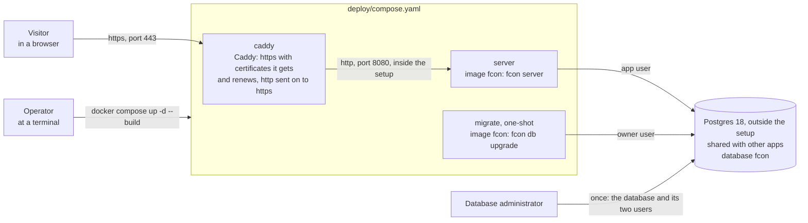
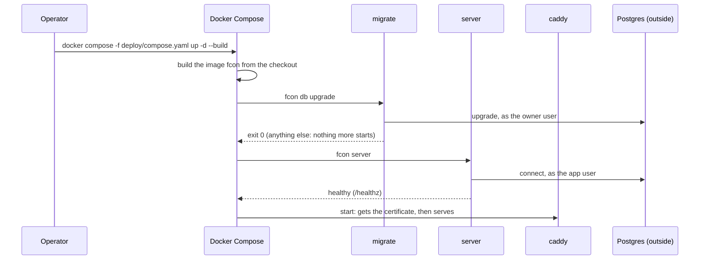
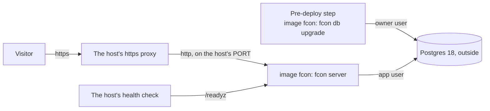

## Context

The product runs only from a checkout (see `proposal.md`). This change packages it as one
container image, adds the production setup for one machine, and writes the guide for a cloud host
that runs containers. The owner agreed its design with the manager session in issue 17, point by
point, on 22-Nov-2026. That checklist is copied below word for word, so the repo keeps every
decision once this change is archived; the issue stays as the record of the discussion. ADR 0015
carries the reasons for the container setup.

The in-force ADRs it builds on: 0001 (Python 3.14 only), 0003 (one Uvicorn process per container),
0004 (Postgres 18 and later only), 0006 (settings only from environment variables) and 0008
(`fcon` as the technical name). The storage foundation (issue 12, PR #15, not merged yet) brings
`fcon db upgrade` and the two database roles (its ADRs 0010 and 0014); the parts of this change
that need them are wired in once it merges.

After the checklist, this file says how the setup is built, and records the four decisions the
checklist left to the build.

## Agreed design (issue 17, owner, 22-Nov-2026)

1. **One image for every role**, `fcon`: the command decides what runs (`fcon server`, `fcon db upgrade`, later `fcon worker`). *Alternative:* one image per role: more to build and keep in step.
2. **Base and build:** `python:3.14-slim-trixie` (Debian 13, like the Postgres 18 image). A build stage installs the three packages with uv into a virtual environment; the final stage copies only that environment, runs as a non-root user, and holds no compiler, no uv and no source tests. *Alternatives:* Alpine (musl: slower Python, gaps in prebuilt wheels); distroless (no shell for debugging, no easy health check).
3. **Inside the image:** `FCON_HOST=0.0.0.0` (#4 point 2); no secret and no `.env` (R15.15); a `.dockerignore` keeps `.env`, `.git` and tests out; a health check that calls `/healthz` with Python's standard library (slim images have no curl); the port from `PORT` or `FCON_PORT`, as the server already does.
4. **Both processor families** (Q-12): `linux/amd64` and `linux/arm64`, built with buildx.
5. **CI:** every PR builds the image for amd64 and runs a smoke test: the container against CI's Postgres service, `fcon db upgrade` (once #12 is in), then `/healthz`, `/readyz` and `/sign-in` answer. The arm64 build runs on `main` only, because building it under emulation is slow. Publishing the image is not here: it comes with releases (R15.7, signed and with a list of what it contains), which also decide the registry (the rest of D-10).
6. **Production on one machine** (R15.2, Q-15): `deploy/compose.yaml` with at most four long-running containers: Postgres 18, the server, Caddy as the proxy that encrypts traffic with automatic certificates (R15.15), and later the worker; plus a one-shot `migrate` container that runs `fcon db upgrade` and must succeed before the server starts (#12 point 9). Settings come from a `deploy/.env` the operator writes, never in git: the two database addresses (#12 point 17), the secret key once sign-in needs it (#16), and the site's domain name for Caddy.
7. **On a cloud host that runs containers:** `docs/deploy.md` covers both ways: the one-machine compose file, and a container host with a managed Postgres 18 (choose the host's 18 image, #12 point 1), the image, the pre-deploy command `fcon db upgrade`, the health-check path `/readyz`, the host's `PORT` followed, and the settings. It names no host.
8. **ADR 0015** records the container setup and settles that part of D-08 (numbered after #12's ADRs; renumbered if `main` takes it first).
9. **Not in this issue:** `fcon dev` (R15.1 needs a demo flow, which comes with areas 1 and 2), publishing and signing images (R15.7), the sizing guide (R15.13), the worker's container (the worker issue).

Review route: code review (the image's security: non-root, no secret, what it contains) and the smoke test; no UI.

**Changed during the change** (owner, 22-Nov-2026): Postgres is not part of the one-machine
setup. It is a Postgres 18 server run by a central administrator and shared with other apps; the
administrator makes the product its own database and its two users. So point 6's setup is the
server and Caddy, plus the one-shot `migrate` container; `deploy/.env` holds the two full database
addresses and the site's name. The spec's "keeps its data" requirement went with the database
container (decision 1).

## How it is built

On one machine, `deploy/compose.yaml` runs three containers, two of them from the image built
from the checkout, and connects to a Postgres the administrator runs:

- Only Caddy publishes ports (80, 443, and 443 over UDP for HTTP/3). The server is reached on the
  setup's own network only.
- The setup holds no data: the database, and its backups, are the administrator's.
- The image is built from the checkout until releases publish it (R15.7); then the compose file
  names the published image instead.
- Assumption: the site's name points at the machine, and ports 80 and 443 reach it, so Caddy can
  get a certificate; the containers can reach the Postgres server. The guide says so.

Start-up, in order. Each step waits for the one before it:

On a cloud host that runs containers, the same image runs twice per deploy:

Build notes. These are plain implementation, settled by the tests in `tasks.md`; none is a
decision of its own:

- **The image** (`Dockerfile` at the repo root). A build stage on the base image copies in the uv
  binary from uv's own image, then runs `uv sync --locked --no-dev --no-editable` into
  `/app/.venv`, twice: first with only the lock file and the four `pyproject.toml` files
  (`--no-install-workspace`), so a change to the code reuses the layer of dependencies; then with
  the packages' sources, which installs the three packages as built wheels, bytecode compiled.
  The final stage, on the same base, adds a system user `fcon` (uid and gid 10001, no home, no
  login shell), copies only `/app/.venv`, and sets `PATH`, `FCON_HOST=0.0.0.0`,
  `PYTHONUNBUFFERED=1` and `PYTHONDONTWRITEBYTECODE=1`; `WORKDIR /app`, `USER 10001:10001`,
  `EXPOSE 8080`, `ENTRYPOINT ["fcon"]` and `CMD ["server"]`, with the OCI labels for the title,
  the licence and the source. `fcon` runs as the container's first process: `fcon server` already
  stops cleanly on `SIGTERM`.
- **What reaches the build** (`.dockerignore`): an allowlist. Everything is left out but the
  workspace's `pyproject.toml` and `uv.lock`, and each package's `pyproject.toml`, `README.md` and
  `src/`; caches are left out inside those. So `.env`, `.git`, tests, the acceptance suite, the
  docs and the skills never reach the build, whatever is added to the repo later.
- **The health check**: `HEALTHCHECK` runs `python -c` with `urllib` against
  `http://127.0.0.1:<port>/healthz`, the port chosen by the server's own rule (`FCON_PORT`, else
  `PORT`, else 8080); every 10 s, every second while starting, failing after three misses.
- **CI** (`.github/workflows/ci.yml`, a new job): buildx with GitHub's build cache builds the
  image for amd64 and loads it, then the smoke test (`scripts/smoke-image.sh`, Linux only) checks
  what the image holds (not root; no uv, no compiler, no `.env`, no `.git`, none of our tests),
  runs `fcon db upgrade` (once #12 is in), starts the server with the host's network against the
  job's Postgres 18, waits until Docker reports it healthy, and checks that `/healthz`, `/readyz`
  and `/sign-in` answer; on a failure it prints the container's log. The arm64 build: decision 4.
- **One machine** (`deploy/`): `compose.yaml` (project name `fcon`; `migrate` and `server` from
  the image built from `..`, each with a read-only file system and `/tmp` in memory, no Linux
  capabilities and no privilege escalation, and `host.docker.internal` mapped to the machine, for
  a Postgres on the same machine; `caddy` on `caddy:2` with volumes for its certificates and its
  configuration; `restart: unless-stopped` for the long-running ones). `Caddyfile`: the site
  `{$FCON_DOMAIN}` proxied to `server:8080`; Caddy's automatic https gets and renews the
  certificate and sends http on to https. The settings: decision 1. `.env.example` lists them;
  `deploy/.env` is already git-ignored by the root's `.env` rule.
- **The guide** (`docs/deploy.md`): what both ways need, starting with the administrator's one-time
  SQL (the database `fcon`, its owner user and its app user, on Postgres 18); then one machine
  (prerequisites, the settings, the one command, checking `/readyz`, logs, upgrading to a new
  version, what a failed upgrade looks like, a Postgres on the same machine); then a cloud host
  that runs containers (choosing the host's Postgres 18 image; the image; the pre-deploy command;
  the start command; `PORT`; the health-check path `/readyz`; the settings); then a table of the
  settings. It names no host.
- **Dependabot**: the `docker` ecosystem for the `Dockerfile` (base image digests; no move off
  Python 3.14, ADR 0001), and `/deploy` added to the `docker-compose` entry (Caddy).
- **`AGENTS.md` § Project**: the stack gains one line for the image and the setup (ADR 0015).
- **The acceptance suite**: decision 3.

## Decisions

### 1. Postgres runs outside the setup; the operator gives its two full addresses

The one-machine setup has no database container (owner, 22-Nov-2026). The database is a Postgres
18 server run by a central administrator, often shared with other apps. The administrator makes,
once, the database `fcon`, its owner user (for upgrades) and its app user (for the server), with
the SQL in the guide; the setup never needs administrator rights on Postgres. `deploy/.env` holds
the site's name and the two full addresses, `FCON_MIGRATION_DATABASE_URL` and
`FCON_DATABASE_URL`: the same settings, by the same names, as on a cloud host. The compose file
refuses to start when one is missing. A Postgres on the same machine is reached at
`host.docker.internal`.

Rejected: a Postgres container in the setup, as point 6 first said, with its volume and a start-up
script that makes the app user. It suits a machine with nothing else on it, but most places
already run a Postgres server that is backed up and looked after; a second one per app has to be
backed up, upgraded and watched again. Also rejected: two passwords in `deploy/.env` from which
the compose file builds the addresses: two sets of settings to learn, one here and one on a cloud
host.

### 2. The image's base images are pinned by digest

The `Dockerfile` names `python:3.14-slim-trixie` and uv's image by tag and digest. Dependabot
proposes a new digest monthly, with the other updates (relaxed until M1, #5). The setup's
`postgres:18` and `caddy:2` stay on their tags, so an operator's `docker compose pull` brings their
fixes.

Rejected: tags alone. Every build would take the newest patch release by itself, but two builds
of the same commit could differ, and a broken or tampered tag would arrive unseen; the workflows
already pin every action by its commit for the same reason.

### 3. The acceptance suite runs the real image and the real setup, in containers of its own

The scenarios run against what an operator runs. The suite builds the image once per run with
`docker build`, and drives containers with the `docker` command only (no new dependency). The
image's scenarios start their own Postgres 18 container on a network of their own. The setup's
scenarios run `deploy/compose.yaml` under a project name of their own, against such a Postgres
container standing in for the administrator's, with a small override file of the suite's that
joins the setup to that network, moves the proxy's ports to free ones and names the site
`localhost`, for which Caddy makes its own certificate; the suite trusts that certificate's
authority and nothing else.
Every name carries the run's port and a random part, so worktrees run side by side; everything is
removed at the end. Without Docker, those scenarios fail, saying to start Docker; they never skip.

Rejected: the image's containers reach the run's database on the shared server through the
host's network. It starts one container fewer, but it works on Docker Desktop and in CI, not on a
Linux machine where the shared database listens on 127.0.0.1 only. Also rejected: a smoke script
in CI alone, with the scenarios as prose: the spec would not run, and the setup would not be
tested at all.

### 4. The arm64 build runs on GitHub's own arm64 machines

Point 5 kept the arm64 build to `main` because building it under emulation is slow. GitHub runs
arm64 machines of its own, free for public repositories, as this one is: there the build is as
fast as amd64's, with no emulation. So the arm64 build keeps point 5's scope, `main` only, but
runs natively, with the same smoke test as amd64 (owner, 22-Nov-2026). The first host in view runs
amd64 only; arm64 serves Q-12, developers on ARM machines, and ARM hosts.

Rejected: emulation (QEMU), as point 5 words it: ten minutes or more per build, for nothing the
native build lacks. Also rejected: the native build on every PR, which finds an arm64-only break
before the merge, for one more job per PR; not worth it while the first host is amd64. And
dropping arm64: Q-12 asks for both families, and it costs nothing on PRs.

## Risks / Trade-offs

- [The acceptance suite now needs Docker running, and its first run builds the image] → Docker is
  already needed for the development database; the layer cache makes later runs quick; without
  Docker the deployment scenarios fail with a message saying so.
- [A real certificate needs the site's name to point at the machine, and ports 80 and 443 open] →
  the guide's first step; Caddy's log says why it could not get one.
- [Losing Caddy's data folder asks for new certificates on every start, which the certificate
  authority limits] → its own volume, kept like the database's.
- [With pinned digests, a fix to the base image waits for Dependabot's monthly proposal] → a
  security fix can be pinned by hand at any time.
- [A password with characters that mean something in an address breaks it] → the guide suggests
  hex passwords and shows how to escape others; the server refuses a malformed address at
  start-up, with its two-part message.
- [A Postgres on the same machine listens on 127.0.0.1 only, which containers cannot reach] → the
  guide says to let it listen on Docker's bridge too, and to allow that network in `pg_hba.conf`.
- [On a new version, `docker compose up -d` stops the old server before the upgrade runs, so a
  failed upgrade takes the site down] → the guide upgrades first with `run --rm migrate`, while the
  old server keeps serving; upgrades only add, so it keeps working.
- [HSTS (telling browsers to use https only) is not sent] → it belongs to the server, which can
  send it on a cloud host too, once it trusts its proxy's headers (with real sign-in, #16).

## Migration Plan

None: nothing is deployed yet. When releases publish the image (R15.7), the compose file names
the published image instead of building it, and the guide follows.

## Open Questions

None.
