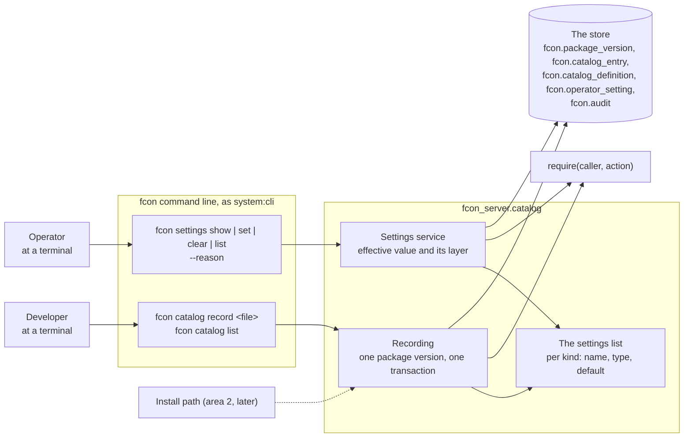

## Context

The contract is issue #31, point 2, amended by its three review rounds, with issue #34's split
(this build: the catalog and operator settings). The store (`fcon_server.store`), the audit log
(ADR 0014) and the one rights check (ADR 0016) exist; nothing records a flow, a dataset or a
route yet. #35 (partitions, versions) is built at the same time and points to this change's
tables: a version points to its stable dataset and records the package version that made it.

Packaging (area 2) does not exist yet, so the catalog is written by a store-level service that
takes one package version's definitions as data; the install path calls it later, and until then
a command stands in for it.

## Goals / Non-Goals

**Goals:**

- Record each flow, dataset and route of a package version, under a stable identity, with that
  package version's own copy of each definition; never change a recorded package version.
- Explicit renames (`renamed_from`).
- The settings an operator owns, per kind, with types and the product's defaults; effective
  value operator, else code, else default; each value's layer shown; every change audited with
  who and why, a reason required in a protected environment; values for names the code no longer
  has flagged, never dropped.
- Leave every door in #31 § Room left for later open.

**Non-Goals:**

- Installing packages, switching a version on (area 2); the dashboard's settings pages (a later
  UI issue); readiness sets' own rows (#37); connections, their settings, budgets and connection
  hours (they belong to a connection, and budgets to the engine design, D-03).
- Acting on any setting: nothing runs a schedule or a retry yet. This change stores and shows
  them; the worker and the engine read them through `effective_settings` later.

## How it is built

- **`fcon_server.catalog`** holds the rules: reading a package version's definitions
  (`definitions`), the settings list (`known_settings`), recording (`recording`) and the
  settings service (`operator_settings`). The command line only parses arguments, calls these
  with a caller, and prints. The dashboard and a JSON route call the same functions later.
- **Tables**, in one expand-only migration, each in `tables.py` and written through the store's
  helpers, so every insert and update is audited:
  - `fcon.package_version`: key `(tenant_id, id)`; `package`, `version`, unique per tenant;
    `checksum` (SHA-256 of the definitions in one canonical JSON spelling). Rows only added.
  - `fcon.catalog_entry`: the stable identity of one flow, dataset or route. Key
    `(tenant_id, id)`; `kind` (`flow`, `dataset`, `route`, a check); `name`, unique per tenant;
    `package`; `package_version_id`, the latest recorded package version that declares it;
    `is_in_code`, whether the latest recorded version of its package still declares it. Rows
    change (a rename, a new package version).
  - `fcon.catalog_definition`: one package version's copy of one entry's definition. Key
    `(tenant_id, id)`; `package_version_id`, `entry_id`, unique together; `name` as that version
    spelled it; `renamed_from`; `definition` (jsonb, the code's whole definition). Rows only
    added.
  - `fcon.operator_setting`: an operator's value for one setting of one entry. Key
    `(tenant_id, id)`; `entry_id` and `setting`, unique together; `value`, text in the setting's
    canonical spelling, or null once cleared. Rows change.
  - Every reference carries the tenant and is indexed, every index starts with `tenant_id`.
- **A definitions file** is JSON: `package`, `version`, and lists `flows`, `datasets`,
  `routes`, each item an object with at least `name`, optionally `renamed_from` and `settings`
  (the code's values of operator settings); everything else in the item is what the code decides
  (the source, the key, the partition scheme, how change is found, a route's dataset and write
  mode, the shape, the event kind) and is kept whole, unread. It is the shape the load check
  will hand the service.

## Decisions

### 1. A catalog entry is the stable identity; its name can change, its id never does

Versions, deliveries and operator settings point to `catalog_entry.id`; the full name is a
column of the entry. A rename changes the entry's name in place (audited), so history and
settings follow without being copied. Names are unique per tenant across kinds, and an entry's
kind never changes: a package version that declares a known name as another kind is refused,
naming both.

Rejected: keying settings and history by the name text (a rename would have to rewrite every
row that names it, in every table later builds add); a new entry per package version (history
split at each upgrade, against #31 point 2).

### 2. Each package version keeps its own copy; the latest recorded one is current

`catalog_definition` holds one row per package version and entry, never updated. An entry's
current definition is the one from the latest recorded package version of its package that
declares it (`catalog_entry.package_version_id`). Recording the same version again with the same
definitions is "already recorded" and writes nothing; with different definitions it is refused
(R2.12), checked by the checksum.

Rejected: one definition per entry, overwritten by each upgrade (a run that started on the old
code could no longer read it, R2.19; no history). Deciding which version is *switched on* per
flow is area 2's (R2.4); it will replace "latest recorded" as the meaning of current, in one
place.

### 3. Recording is one transaction, serialised per package

The service takes a transaction-scoped advisory lock on the tenant and package, then: inserts
the package version (`insert_if_absent`, so two recordings of one version can't both go in),
resolves or creates each entry, inserts the definitions, and moves every entry of the package to
the new version or marks it no longer in code. Two packages record in parallel. Either all of a
package version is in the catalog, or none of it.

Rejected: locking the package's entries `FOR UPDATE` (new names can't be locked before they
exist, so two recordings could both create one and the second fail on the unique name).

### 4. A rename moves the old entry to the new name, only when it is safe

For an item with `renamed_from`: when the new name is already an entry, it is used and the old
name is left alone (the rename happened in an earlier version). Else when the old name is an
entry of the same package and kind, not declared again by this version, the entry is renamed.
Else (the old name was never here, for example a fresh environment) it is a new entry. A rename
across packages or kinds, or one whose old name is still declared by the same version, is
refused, naming both names.

### 5. The settings an operator owns are a list in code, one line each

`known_settings` lists, per kind, each setting's name, its type and the product's default. Types:
a length of time (`90s`, `15m`, `12h`, `3d`), a count with a least value, `on`/`off`, a choice
from a fixed set, a time zone, a schedule (five cron fields), and a time with its offset (for a
pause's end), the last three optionally `none`. One parser per type checks a value and gives its
canonical spelling, or says what is expected. The code's values in a definitions file go through
the same parsers when it is recorded; an unknown setting there refuses the recording, naming it.
A name the code decides (`key`, `source`, `write-mode`…) is refused with "decided by the code".

The list (first version; each a line, so adding one is a one-line change and no migration):

| Kind | Settings (default) |
|---|---|
| Flow | `on` (off, R2.3), `schedule` (none), `time-zone` (UTC), `paused-until` (none), `tries` (6), `time-limit` (1h), `parallel-work` (1), `overlap` (skip), `catch-up` (latest), `alert-after-failures` (1) |
| Dataset | `look-back` (0s), `full-comparison-schedule` (none), `batch-size` (5000), `tries` (6), `time-limit` (1h), `readiness-interval` (5m), `late-data` (warn), `schema-changes` (ask), `alert-when-stale-after` (none), `keep-records` (14d), `keep-versions` (400d), `fetch-batch-size` (100), `fetch-tries` (6), `fetch-time-limit` (30s) |
| Route | `on` (on), `paused-until` (none), `tries` (6), `time-limit` (1h), `batch-size` (5000), `parallel-partitions` (1), `approval` (never), `supersede-automatically` (off), `parent-wait-limit` (1d), `alert-after-failures` (1), `keep-deliveries` (180d), `keep-answers` (30d) |

Keeping times follow #31 point 10's defaults. Aligned with the engine design (#42, owner,
28-Nov-2026): `tries` counts every try, the first included, 6 by default (#42 point 4; the
engine spreads them over about 30 minutes with growing randomised waits, and adds the first and
longest wait and the "retry after" cap as settings when it is built); `overlap` is R5.8's
`queue` (the new run waits behind), `skip` (recorded as skipped, "previous run still going") or
`cancel` (the running run stops at its tasks' next safe point and the new one starts), with
parallel work its own setting (R6.8); `catch-up` is `latest` (one run, the others recorded as
skipped, "caught up as one run"), `each` (one run per missed start, up to the engine's cap of
1,000) or `none` (#42 point 5). Values are stored as text in their canonical
spelling; the readers that act on them (the worker, the engine) parse them with the same parsers.

Rejected: a table of setting kinds in the database (a migration per new setting, and rules
split between SQL and code); one jsonb document of overrides per entry (one setting's change
would rewrite and lock all of them; no row per setting for the audit to name).

### 6. Clearing sets the value to null; no row is deleted

The store has no delete, and a deleted row would lose its row version. A cleared setting keeps
its row with a null value; setting it again updates the same row. The audit log shows each
change, before and after. A null value is "no operator value", not a deleted flag.

### 7. A value for a name the code no longer has is flagged by its entry

When a package version no longer declares an entry, the entry stays with `is_in_code = false`,
and the operator's values stay with it. Recording logs and prints a warning for each such value;
`fcon settings list` shows every operator value with a flag; `fcon settings show` on such a name
says it is no longer in the code. Such a value can be cleared, not set. If a later version
declares the name again, the entry is back in the code with its values.

### 8. A protected environment: `FCON_PROTECTED`

`FCON_PROTECTED` (`on` or `off`, default `off`; `on` in the deployment template) marks the
environment protected (R9.2). The settings service takes it as an argument; under it a change
with no reason is refused, the refusal audited (`refused`, R10.4), and nothing written. The
reason travels as the context's reason, onto the change's audit record.

Rejected: deriving it from `FCON_ENVIRONMENT=production` (a test environment can be protected
too, and a name is a weak switch).

### 9. Rights

Three actions in the one rights table: `see settings` (viewer), `change settings` (operator),
`record the catalog` (developer). The command line acts as `system:cli` with every right, as
`fcon users` does.

## Threats

- **A signed-in user with less permission** (later, through the dashboard) changes a setting:
  `require(caller, change settings)` in the service, denied by default; inner tests per role.
- **A user of another tenant** reads or changes these rows: every query is scoped to the
  context's tenant by the store, and each test runs in a tenant of its own.
- **A crafted definitions file** (by whoever runs the command; later, a package): every name,
  version and setting value is checked at the edge against its rule, with a size limit on the
  file; definitions are stored as jsonb data and never run. Values are printed as text by the
  command line, never as HTML.
- **A secret written into a definition or a setting**: settings hold no secrets by design
  (connections do, later); a definition is the code's own declarations. Both are audited in full,
  so the docs say never to put a secret there.
- **An unexplained change in a protected environment**: refused without a reason, and the
  refusal audited.

## Risks / Trade-offs

- The settings list and its defaults are a first version, made before the features that read
  them; renaming one later needs a step that moves operator values. Kept small and in one list so
  that step is easy.
- "Latest recorded is current" is wrong once versions can be switched on and back (R2.4); it is
  one query, replaced by area 2.
- A schedule is checked for shape (five fields of digits, `*`, `,`, `-`, `/`), not for ranges;
  the scheduler checks it fully when it comes.

## Migration Plan

One migration that only adds four tables; the previous version runs on the new database
unchanged. Undoing: nothing reads the tables yet but the new commands. `tzdata` becomes a direct
dependency of `fcon-server`, so time zones resolve on every platform (ADR 0019).

## Open Questions

None for the build. The choices made where #31 does not say (the settings list and its
defaults, `FCON_PROTECTED`, the rights, the command line as the stand-in) are listed in the PR
for the owner to confirm.
