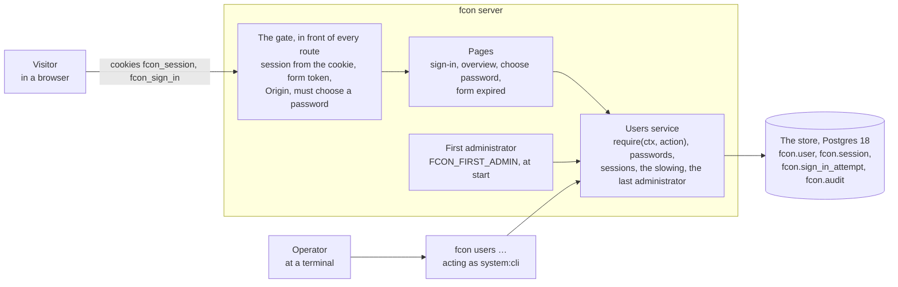

## Context

The dashboard shows a sign-in page that refuses everyone (see `proposal.md`). This change adds
users, passwords, sessions, the form token, the slowing of repeated failures, the visitor's real
address, the first administrator, and the first pages behind sign-in. The owner agreed its design
with the manager session in issue 16, point by point, on 22-Nov-2026, with mockups for the
overview, choose-password and form-expired pages. That checklist is copied below word for word, so
the repo keeps every decision once this change is archived; the issue stays as the record of the
discussion. The ADRs 0016 to 0018 carry the reasons for what is hard to undo.

It builds on the store of issue 12 (ADRs 0009 to 0014: a tenant on every row and call, the store's
helpers, the audit log written by the store, two database roles), the container setup of issue 17
(ADR 0015), settings only from `FCON_*` variables (ADR 0006) and the strict content policy
(ADR 0007).

After the checklist, this file says how sign-in is built, and records the four decisions the
checklist left to the build.

## Agreed design (issue 16, owner, 22-Nov-2026)

1. **The first administrator** (the catalogue gap noted in #4; owner, 22-Nov-2026):
   - `fcon users add <name> --admin` asks for the password, or reads it from stdin when not a terminal. On one machine: `docker compose run --rm server fcon users add …`; on a cloud host, its own shell.
   - For a host where one-off commands are awkward: the setting `FCON_FIRST_ADMIN=<name>` makes the server, on a start with no users, create that administrator with a random one-time password written to its log once (`warning: no administrator yet; made "ann" with a one-time password: …` / `Sign in at /sign-in and choose your own password. Remove FCON_FIRST_ADMIN afterwards.`). The password works for one sign-in, then the user chooses their own (R10.1). No password ever sits in a setting.
   - The first user made is always an administrator, with or without `--admin`, so an install never has users but no administrator (R10.13).
   - Making the first administrator is audited like any change, by `system:first-admin` (from the setting) or `system:cli` (from the command); the password is never written there.
   - Not chosen: a name and password in settings (the password would sit in the host's settings); a setup page open to whoever comes first (a race anyone on the network can win).
2. **Users and roles** (R10.1, R10.2; owner, 22-Nov-2026):
   - A user belongs to one tenant: `fcon.user (tenant_id, id)`. A person in two tenants has two users, as in the sandbox model. M1 sign-in has no tenant field; M2 decides how the sign-in form names the tenant and who manages tenants for the whole install. Not chosen: install-wide accounts with memberships (a table outside every tenant, against R14.3).
   - One role per user, text with a check (`viewer`, `operator`, `developer`, `administrator`), and the two grants as yes/no columns `is_hold_approver` and `is_personal_data_reader`. Not a permissions table.
   - Rights are checked in one place: a table in code maps each action to the least role it needs, and `require(ctx, action)` checks it in the service layer the dashboard, the API and the command line all use (R8.6, D-14). A refusal is audited (R10.4).
   - User names: lowercase letters, digits and `. _ - @ +`, 1 to 64 characters (an email address works), stored lowercased, unique within the tenant, `pg_c_utf8`; an optional display name beside it.
   - A state, `active` or `disabled`; users are never deleted. Disabling ends every session at once. `must_choose_password` is set when an administrator sets a password (and for the one-time password of point 1), cleared when the user chooses their own (R10.1).
   - The command line: `fcon users add`, `list`, `disable`, `enable`, `set-role`, acting as `system:cli`. The dashboard pages come in the next issue.
3. **Passwords** (owner, 22-Nov-2026):
   - argon2id through `argon2-cffi` at OWASP's recommended strength (19 MiB, 2 passes); its settings are stored with each hash, and a hash is redone at the next sign-in when they rise. Measured on this machine: 34 ms and 19 MB per sign-in, against 2,243 ms and 128 MB for scrypt at the recommended strength. Not scrypt, not bcrypt.
   - At least 12 characters, at most 128, any characters, no composition rules; refused if it is one of the most common passwords (a short list shipped with the product) or the user's own name. The message says which rule failed.
   - A password set by an administrator, or the one-time password of point 1, works for one sign-in; the user must then choose their own before any other page opens (`must_choose_password`). Every password change ends every other session of that user.
4. **Sessions** (R10.7, R10.12; owner, 22-Nov-2026):
   - Kept in the database, `fcon.session`, tenant-scoped; the browser holds only a random id. Signing out, a new password or disabling a user ends every session of that user at once. Not signed cookies (they can't be ended from the server).
   - The id is 32 random bytes; the database stores only its SHA-256 hash. A new id at every sign-in. Cookie `fcon_session`: `HttpOnly`, `Secure` behind https, `SameSite=Lax`, `Path=/`.
   - A session ends after 12 hours idle or 7 days at most; "last seen" is written at most once a minute.
   - A session carries the tenant and the user; the role is read fresh on each request, so a demoted user loses rights at once. It also records when and how it was made (`password`, later `identity-provider`), the browser's address and user agent. The request id comes from #12.
   - Sign-in and sign-out are audited; the session id is never written anywhere but its cookie.
5. **The token against forged requests** (R10.7; owner, 22-Nov-2026):
   - The session row holds a random token; every form includes it through the template helper `csrf_field()`; every POST, PUT, PATCH and DELETE is checked. A request without the right one gets a plain "This form has expired. Reload the page." page with status 403 and is audited as refused.
   - A second wall on top: a request whose `Origin` names another site is refused before the token is checked.
   - The sign-in form has a token of its own, tied to a short-lived cookie issued with the sign-in page (against login CSRF).
   - API calls use tokens in a header and need no form token (the API issue); a page calling the API (HTMX) sends the token as a header, added by the HTMX setup.
   - Not relied on alone: `SameSite=Lax`, or the `Origin` check.
6. **The secret key** (R15.15; owner, 22-Nov-2026):
   - `FCON_SECRET_KEY`, at least 32 random bytes, signs short-lived cookies made before a session exists (the sign-in form's, later redirect messages). The server refuses to start without one, or with one too short: a settings mistake, exit code 2, two-part message.
   - Required in every environment; `scripts/worktree_env.py` writes a random one into each worktree's `.env`, and `.env.example` says how to make one.
   - `FCON_SECRET_KEY_PREVIOUS` is also accepted while signatures from the old key run out (about 10 minutes), so a leaked key can be replaced without signing anyone out.
   - Never logged, never audited, never in the image.
   - Sealing stored secrets (R10.3, R10.14) gets its own key, `FCON_SEAL_KEY`, in the secrets issue; not one key for both.
7. **Slowing repeated failures** (R10.12; owner, 22-Nov-2026):
   - After **3** failed sign-ins within 15 minutes, for the same user name from any address or from the same address for any user, each further attempt must wait: 1 s, 2 s, 4 s and so on, up to 1 minute after the last failure. A success clears that user's count. No account is ever locked (an attacker could lock out anyone, the administrator included); no CAPTCHA.
   - Every refusal uses the same words ("The user name or password is wrong."), even while waiting, and takes the same time: a made-up name still runs one argon2id check against a dummy hash. An attempt during the wait is refused without checking the password.
   - Counted in `fcon.sign_in_attempt` (tenant, name tried lowercased, address, time, outcome; rows only added; a daily clean-up removes rows older than a day), so it holds across server copies. The address is the visitor's real one (point 8). Each refusal is also audited (point 11).
8. **The visitor's real address behind the host's proxy** (deferred in #4; owner, 22-Nov-2026):
   - Forwarded headers are believed only from addresses listed in `FCON_TRUSTED_PROXIES` (addresses or ranges, comma-separated; `*` for hosts where only the proxy can reach the container). Without it they are ignored, and the server logs once: `warning: requests carry X-Forwarded-For, but no proxy is trusted; set FCON_TRUSTED_PROXIES.` The deployment guide says what to set for the compose setup and for container hosts.
   - The real address is the last hop in `X-Forwarded-For` that is not a trusted proxy.
   - The session cookie is always `Secure`, except when the server listens only on its own machine (plain http in development), so a wrong proxy setting can't weaken sessions. `X-Forwarded-Proto` is used only for full addresses in emails or links, which nothing writes yet.
9. **Where a visitor lands, and the first pages** (owner, 22-Nov-2026; mockups agreed in the manager session):
   - After signing in, back to the page asked for (`/sign-in?next=/runs/42`), only when it is a path on this site (starts with one `/`, not `//`, not a full URL); otherwise the overview.
   - The overview is the dashboard's first frame: the product name, the environment's name from the new setting `FCON_ENVIRONMENT` (default `development`), who is signed in with which role, and a Sign out button (a form with its token, never a link). The body says nothing is there yet (R7.18, the parts that exist).
   - The choose-password page ("Choose your password", "The one you were given works only once.", new password twice, "At least 12 characters.", Save password) comes before any other page while `must_choose_password` is set.
   - The "This form has expired" page (status 403, "Reload the page and try again.", a link to the overview) uses the same card as sign-in.
10. **Always an administrator** (R10.13; owner, 22-Nov-2026): the last active administrator can't be disabled, demoted or removed, from the command line now or the dashboard later. The refusal says why ("ann is the only administrator; make another one first.") and is audited as refused. The check runs in the same transaction as the change, so two administrators demoting each other at once can't both succeed.
11. **Audit** (R10.4; owner, 22-Nov-2026): every sign-in, refused sign-in, wait, sign-out, password change, user added, disabled, enabled or given a role goes to the audit log through the store's helper, refusals included. Passwords, password hashes and session ids are secret columns, never written there. Records carry the visitor's real address (point 8).
12. **Not in this issue** (owner, 22-Nov-2026): API tokens (R10.1, R10.11, the token part of R10.13) with the first API issue; the user-management pages next; a "your sessions" list and signing out other sessions from the dashboard later; sign-in through an identity provider in M2 (R10.8).

Review route: UI (sign-in, the overview, choose-password, form expired) with an independent verifier at 1280 px, and a code review for security, sessions and the audit.

**Settled while writing the specs** (owner, 22-Nov-2026): a password set from the command line
works for one sign-in, like one an administrator sets, except the first user's: whoever installs
the product types it for themselves, so it is their own.

## How it is built



- **The users service** (`fcon_server.users`) is the one place for every rule here: the rights
  table and `require(ctx, action)`, user names, password rules and hashing, sessions, the
  slowing, the last-administrator check, the first administrator. The pages and `fcon users` call
  it with a context; neither talks to the store directly. A JSON route can later call the same
  functions (AGENTS.md § Front end).
- **Tables**, in one new migration, each through `tables.py` and the store's helpers:
  - `fcon.user`: key `(tenant_id, id)`; `name` unique within the tenant (`pg_c_utf8`); the
    display name; `role` and `state` as text with a check; `is_hold_approver`,
    `is_personal_data_reader`; `password_hash` (secret); `must_choose_password`; rows change.
  - `fcon.session`: key `(tenant_id, id)`; `id_hash` (SHA-256 of the cookie's id, unique, secret),
    `form_token` (secret), `user_id` referencing the user, `made_by` (`password`), `address`,
    `user_agent`, `last_seen_at`, `expires_at`, `ended_at`; rows change. Signing out sets
    `ended_at`; nothing is deleted.
  - `fcon.sign_in_attempt`: tenant, the name tried (lowercased), the address, the outcome
    (`succeeded`, `refused`, `waited`); rows only added; indexed by `(tenant_id, name, created_at)`
    and `(tenant_id, address, created_at)`.
- **Signing in**, for every attempt the same steps, so a made-up name takes as long as a real one:

  ```mermaid
  sequenceDiagram
    participant B as Browser
    participant G as Gate and sign-in page
    participant U as Users service
    participant S as Store
    B->>G: POST /sign-in, name, password, sign-in token
    G->>G: Origin is this site; token matches the fcon_sign_in cookie
    G->>U: sign_in(name, password, address)
    U->>S: failures in 15 min for this name, and for this address
    alt still waiting
      U->>S: add attempt, waited (audited)
      U-->>G: refused
    else not waiting
      U->>U: argon2id check, against a dummy hash when no such user
      alt wrong, or the user is disabled
        U->>S: add attempt, refused (audited)
        U-->>G: refused
      else right
        U->>S: add attempt, succeeded; new session (audited); rehash if weaker
        U-->>G: the session's id
      end
    end
    G-->>B: refused: the form again, same words / right: 303 to next or /, cookie fcon_session
  ```

- **The gate** is ASGI middleware outside FastAPI's routes (decision 1). For every request but
  the open list it reads `fcon_session`, hashes it, loads the session and its user in the tenant
  (decision 2), ends it if idle or past its last day or the user is disabled, writes "last seen"
  at most once a minute, and puts the user and the context (`user:<id>`) on the request. With no
  session it redirects to `/sign-in?next=<path>`. While `must_choose_password` is set, every page
  but choose-password and sign-out redirects there. On POST, PUT, PATCH and DELETE it refuses an
  `Origin` naming another site, then a form token (field `csrf_token`, or the header
  `X-CSRF-Token`) that is not the session's, with the form-expired page (403) and a refused audit
  record. A request it lets through without a session (sign-in, health) carries a context of
  `system:anonymous`.
- **The sign-in form's token**: the sign-in page sets `fcon_sign_in`, a cookie of a random value,
  the time and an HMAC-SHA-256 of both under `FCON_SECRET_KEY`, valid 2 hours; the form carries the
  same value. The check accepts a signature by `FCON_SECRET_KEY` or `FCON_SECRET_KEY_PREVIOUS`.
  The standard library's `hmac` does this; no new dependency.
- **Passwords**: `argon2-cffi`'s `PasswordHasher` with OWASP's recommended settings (19 MiB, 2 passes,
  1 lane), set explicitly rather than from one of RFC 9106's profiles; `check_needs_rehash` after a good sign-in. The list of
  common passwords is a text file in the package: the 10,000 most common from a public list under
  an open licence, keeping those of 12 characters or more (the shorter ones are refused anyway).
  A name is compared lowercased, and so is the password against it.
- **The secret key**: `FCON_SECRET_KEY` must be at least 32 characters; `.env.example` gives the
  command that makes one (`python -c "import secrets; print(secrets.token_urlsafe(32))"`).
  Read with the other settings by `fcon server`; a missing or short one is a settings problem
  (exit code 2, what is wrong and what to do).
- **The real address**: `FCON_TRUSTED_PROXIES` is parsed with `ipaddress` into networks, or `*`.
  The middleware takes the peer's address; when the peer is trusted, it walks `X-Forwarded-For`
  from the right and takes the first hop that is not trusted. Without the setting, a request
  carrying `X-Forwarded-For` logs the warning once per process. `deploy/compose.yaml` sets the
  setup's network for the server, so Caddy is trusted there.
- **The cookie's `Secure` flag** is set unless the server listens on a loopback address
  (`127.0.0.1`, `::1`, `localhost`), whatever `X-Forwarded-Proto` says.
- **Templates**: `csrf_field()` is a Jinja global that prints the hidden field from the request's
  session; the pages share `base.html` and the centred card of `sign_in.html`. No inline script
  or style (ADR 0007). The overview's header shows `FCON_ENVIRONMENT`.
- **`fcon users`** in `fcon-cli`: `add <name> [--admin] [--role R] [--display-name D]`, `list`,
  `disable`, `enable`, `set-role <name> <role>`. The password is read with `getpass` on a
  terminal, else one line from stdin. It uses `FCON_DATABASE_URL`, with a context of the tenant
  `default` and `system:cli`. Refusals (the last administrator, a weak password, a name taken)
  are problems through the error helper, exit code 2.

## Decisions

### 1. Pages are closed by default

Every route needs a signed-in user unless it is on one short list of open ones (sign-in, health,
readiness, the stylesheet). The check runs once, in the gate before any route, and also sends a
user who must choose a password to that page. *Rejected:* each route asking for the user itself
(a FastAPI dependency): explicit where the route is read, but one forgotten route is open to
anyone, and no test fails unless someone wrote one for that page. Here a forgotten entry makes a
page too closed, which shows at once.

### 2. Every request belongs to the tenant `default` until M2

Sign-in has no tenant field, and the store refuses any query without a tenant. Until M2, every
request and command belongs to the tenant `default`, named in one function, `request_tenant()`.
Sessions, users and sign-in attempts are looked up in that tenant. M2 replaces that one function,
by the site's name or a field on the form. *Rejected:* the tenant in the session cookie: sign-in
would still need a way to name it, and the cookie would no longer be only a random id (point 4);
a setting `FCON_TENANT`: a third way to name a tenant, beside what M2 brings.

### 3. Sign-ins reach the audit log through the store

A sign-in attempt is a row added through the store, so its audit record comes with it (name
tried, address, outcome). A session made or ended is a store write too. A change refused for a
rule (the last administrator, an expired form) goes through a new store helper,
`tx.refuse(table, row_key, reason)`, that writes a `refused` audit record and nothing else.
Attempts older than a day are removed by each sign-in, at most 100 at a time, because no worker
exists yet. *Rejected:* the sign-in code writing its own audit records: plainer records, but a
second way to write the log, which ADR 0014 avoided, and a forgotten call goes unnoticed; a
clean-up thread on a timer: every server copy runs one, a background job before the worker
exists.

### 4. The first administrator is made once the database is ready

With `FCON_FIRST_ADMIN` set, the server tries to make that administrator when it starts, and, if
the database is not ready, again every 5 seconds in the background until it is. It does nothing
when any user exists. Two server copies starting together make it once: the name is unique, the
row goes in with `ON CONFLICT DO NOTHING`, and only the copy whose row went in writes the password
to its log. *Rejected:* trying only at start: on a host that starts the server before the
database, nothing happens until the operator notices and restarts; refusing to start: the host
restarts the container in a loop, which looks like a crash.

## Risks / Trade-offs

- **The one-time password sits in the log** until the log is rotated, and anyone who can read the
  log can use it until the administrator signs in. It works once, and the log line says to remove
  `FCON_FIRST_ADMIN`; the command line keeps a password out of the log altogether.
- **The slowing can make the real user wait**, up to a minute, while someone guesses their name.
  Accepted (point 7): no account is locked, and the wait ends by itself.
- **Every page reads the session from the database.** One indexed lookup per request; "last seen"
  is written at most once a minute.
- **`*` in `FCON_TRUSTED_PROXIES`** believes anyone who can reach the container. The guide says
  to use it only where the proxy alone can.
- **The common-password list** is a fixed copy; a new leak doesn't reach it until a release.

## Migration Plan

- One migration adds the three tables, expand-only (convention 15). No data to move.
- **BREAKING**: `FCON_SECRET_KEY` is required. `scripts/worktree_env.py` writes one into each
  worktree's `.env`; `deploy/.env.example` and `docs/deploy.md` say how to make one; CI's smoke
  test and the acceptance suite pass one. An install without it refuses to start, saying what to
  do.
- Rollback: the previous version ignores the new tables and the new settings.

## Open Questions

None. In-force ADRs stay as they are; ADR 0016 settles catalogue question D-14 for the rights
check.
