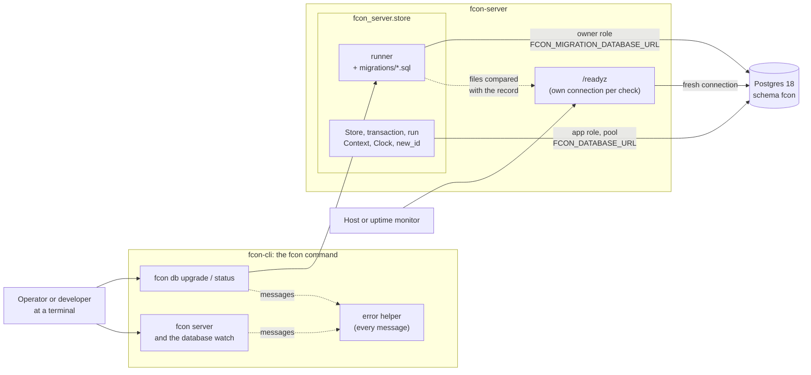

## Context

The skeleton connects to Postgres but stores nothing (see `proposal.md`). This change decides,
once, how the product stores data, and builds the foundation sign-in and every data area add
their tables to. The owner agreed its design with the manager session in issue 12, point by
point, on 21-Nov-2026. That checklist is copied below word for word, so the repo keeps every
decision once this change is archived; the issue stays as the record of the discussion. Its
points keep their numbers (13 to 17 come after 11, and 12 is last). The ADRs `adr/0009` to
`adr/0014` carry the reasons for the six decisions that are hard to undo.

After the checklist, this file says how the foundation is built, and records the seven decisions
the checklist left to the build, each agreed with the owner on 21-Nov-2026.

## Agreed design (issue 12, owner, 21-Nov-2026)

1. Tenants and environments (R14.1, D-05; owner, 21-Nov-2026):
   - Every table has a `tenant_id` column, part of the key of every row, so one tenant's id can never reach another's row. The store layer adds the tenant to every query in one place, and a test checks it. In M2, Postgres row-level security adds a second wall on the same column (R14.3).
   - The tenant of a call comes from who is calling (session or token), never from the address or the request body. With one tenant, addresses never show it (R14.1).
   - The same tenant goes on every log line, audit record, token, session and background job. Each request and job carries it in one context object; no code reads it from anywhere else.
   - A tenant id is a short name fixed at creation, such as `default`; a display name can be added beside it later. M1 has one tenant, `default`.
   - Each environment is its own deployment with its own database (R9.1); its name is the setting `FCON_ENVIRONMENT`, shown on every page (R7.18). No environment column.
   - Sandboxes, after the hosted-platform model: the tenant table also holds a kind (production or sandbox) and the tenant it was made from, so M2 can add sandbox tenants without a rewrite. M1 has one production tenant. A sandbox that must try a new product version is its own deployment, as an environment is.
   - The catalogue gains one M2 requirement: sandboxes created and refreshed from production in one step, copying setup and never production's secrets, with changes promoted back after a preview.
   - `AGENTS.md` § Project gains a convention: every table, call, token, session, log line, audit record and job carries the tenant; code takes it only from the request's or job's context.
2. Upgrading the database (R15.3; owner, 21-Nov-2026):
   - Plain SQL files in the store package, applied by a small runner of our own: no new dependency, forwards only, each file recorded with a checksum, and a file changed after it ran is refused. Not yoyo (rollback files go against forwards-only), not Alembic (it needs SQLAlchemy and reports "multiple heads" when two worktrees each add a migration), not a separate toolchain.
   - Expand, then contract: a migration only adds (tables; columns that are optional or have a default), so the running version keeps working; removing or renaming waits for a later release, once no running code uses the old shape. The rule goes in `AGENTS.md`, and the code review checks every migration against it.
   - A Postgres advisory lock lets one process upgrade while the others wait. Each file runs in a transaction; a file that must run outside one (an index built without blocking writes) says so in its first line.
3. Migration names (owner, 21-Nov-2026):
   - A UTC timestamp, then a short name: `20261121T1530Z_add_tenant.sql`.
   - The runner applies every file it has not recorded, in name order, even one older than the newest applied: expand-only migrations do not depend on each other's order, so a long-running branch can merge late.
   - CI fails when two files share a timestamp, or when a file that ran was changed (its checksum).
4. Where the store lives (owner, 21-Nov-2026):
   - The store (the product's own tables, their queries, the migrations and their runner) lives on the host side, in `fcon-server` as `fcon_server.store` with its `migrations/` folder. The server and the future worker use it; `fcon-sdk` never holds database code (ADR 0002). Whether the worker joins `fcon-server` or gets its own package is the worker issue's decision; if it gets its own, the store moves to a package both use.
   - When area 1 or 3 needs to run flows without Postgres, the SDK gets an in-memory stand-in and a definition of what a store must offer; the Postgres store meets the same definition, checked by one shared test suite. Not designed now.
5. The Postgres schema (owner, 21-Nov-2026):
   - The product's tables live in their own schema, `fcon` (convention 10), created by the first migration; the runner's record of applied migrations is `fcon.migration`.
   - SQL always names tables in full (`fcon.tenant`); no reliance on `search_path`, so a same-named table elsewhere can never be picked by mistake.
6. Ids (owner, 21-Nov-2026):
   - UUIDv7, stored as Postgres `uuid`; a row's key is `(tenant_id, id)`. Unique everywhere, so sandbox copies and promotion between environments never collide; time-ordered, so new rows go at the end of the index; not guessable. Measured on Postgres 18 (one million rows): lookups as fast as `bigint`, the key index about 30% larger, far smaller than with random UUIDs (v4).
   - Made in Python by one helper, `new_id()` (Python 3.14's `uuid.uuid7()`), so the id is known before the row is written and tests can swap in fixed ids. The time inside an id is for ordering only; tables keep their own `created_at`.
   - The dashboard shows the first 8 characters; addresses use the full id. Business keys from source systems are separate, stored as text.
7. Times, and who changed what (owner, 21-Nov-2026):
   - Times are stored as `timestamptz` in UTC; Python uses time-zone-aware times only, in UTC. Where a zone matters to people it is stored beside the time (a schedule's zone, R5.1; later a viewer's display zone).
   - "Now" comes from one clock object handed to the code; tests use a clock they set and move by hand. SQL never calls `now()`: a query is given its times as values.
   - The API and logs write ISO 8601 in UTC (`2026-11-21T17:30:14.666Z`); pages show the viewer's zone, with UTC on hover.
   - Every table has `created_at` and `created_by`; tables whose rows change also have `updated_at` and `updated_by`. Rows only ever added (log lines, audit records, delivery attempts, migration records) have the first pair only. "By" is a text reference that survives a disabled user or a revoked token: `user:<id>`, `token:<id>`, or `system:scheduler`, `system:worker`, `system:migration`. The store layer fills them from the request's or job's context and the clock; no query sets them by hand, and there are no triggers. They show the latest change only; the audit log (R10.4, R7.8) keeps every change.
   - `AGENTS.md` § Project gains a convention for these columns.
8. Text comparison and sorting (owner, 21-Nov-2026):
   - Text used as a key or compared exactly (tenant ids, flow names, business keys, partition keys) uses Postgres's built-in `pg_c_utf8` collation, set on each column in its migration (`tenant_id text collate pg_c_utf8`), so the order is the same on every platform and never changes on an upgrade.
   - Lists people read are sorted for people in the query that shows them (`order by name collate "und-x-icu"`); that collation is never stored in an index.
   - The server checks once at connect that `und-x-icu` exists; without ICU, lists fall back to character-code order and one warning is logged.
9. Who runs upgrades, and readiness meanwhile (R15.16, the "out of date" part; owner, 21-Nov-2026):
   - `fcon db upgrade` applies waiting migrations; the deployment runs it in the host's pre-deploy step, before the new version starts. In development `scripts/worktree_env.py` runs it after creating the database; the tests and the acceptance suite run it on their throwaway databases. The server never changes the database itself. `fcon db status` lists what has run and what waits, and changes nothing.
   - The server compares the database with the code when it connects and on each readiness check (one small query):
     - up to date: ready;
     - behind: not ready, `"database": "unavailable"`; log: `warning: the database is 2 upgrades behind this version. Not ready.` / `Run: fcon db upgrade`;
     - ahead (after going back to an older version): ready; log: `info: the database has 1 upgrade newer than this version; expand-only upgrades keep it working.`;
     - a migration file changed after it ran: not ready; log: `error: upgrade <file> has changed since it ran. Restore it; never edit a migration that ran.`
10. Test isolation for tables (owner, 21-Nov-2026):
   - Each test run creates its throwaway database, runs `fcon db upgrade` on it once, and drops it at the end, so the migrations are tested on every run.
   - Each test works in a tenant of its own, made by a fixture with a random name (`test_7f3a2c`). No clean-up is needed, tests can later run in parallel on one database, and a store query that forgets the tenant makes tests fail. Tables without a tenant (`fcon.migration`) are only read by tests. A cross-tenant test creates two tenants.
11. The first tables (owner, 21-Nov-2026):
   - `fcon.audit` (point 16, rows only added).
   - `fcon.migration` (rows only added): `name` text `pg_c_utf8` key; `checksum` text; `created_at`, `created_by` (`system:migration`).
   - `fcon.tenant` (rows change): `tenant_id` text `pg_c_utf8` key; `kind` `production` or `sandbox`; `made_from` referring to another tenant, empty for now; `created_at`, `created_by`, `updated_at`, `updated_by`; `row_version`.
   - The first migration creates the schema `fcon`, the three tables, and the `default` production tenant.
   - Code: the runner with `fcon db upgrade` and `fcon db status`; the store's helpers (`new_id()`, the clock, the context object carrying the tenant and the actor, and the one helper that scopes every query to the tenant and fills `updated_*` and `row_version`); the readiness checks of point 9; `scripts/worktree_env.py` running the upgrade; the per-test tenant fixture; the new conventions in `AGENTS.md` (tenant everywhere, the who-and-when columns, concurrency, text keys).
   - No other table: sign-in is the next issue and adds its own.
13. Concurrency (owner, 21-Nov-2026):
   - Built here: every table whose rows change has a `row_version` number. An edit applies only if the row is still at the version that was read, and sets the next one; otherwise nothing changes, the page says the row was changed by someone else since it was opened and offers a reload, and the API answers 409. The store helper that fills `updated_*` fills it too.
   - Rule for the worker and durable-execution issues (area 6, D-03): work is claimed with Postgres's `FOR UPDATE SKIP LOCKED` and a lease that expires, so each job goes to one worker and a dead worker's job is picked up again; no separate queue system.
   - Rule: what must happen once is enforced by a unique constraint, written with `INSERT … ON CONFLICT DO NOTHING` (for example one delivery per data version and destination). The API's repeated-call key (R8.9) works the same way, in a table of keys the first API issue adds.
   - Rule: Postgres's default isolation and short transactions; never a transaction held open while calling another system (record the intent, commit, call, record the answer); rows locked in a fixed order, tenant then id.
   - `AGENTS.md` § Project gains one convention line covering these rules.
14. Connections and transactions (owner, 21-Nov-2026):
   - One helper opens every transaction, `with store.transaction(ctx) as tx:`, carrying the tenant and the actor; no query runs outside one.
   - psycopg's pool, 5 connections per process by default (`FCON_DATABASE_POOL_SIZE`), connections recycled every 30 minutes.
   - On every connection: `statement_timeout` 30 s, `lock_timeout` 5 s, `idle_in_transaction_session_timeout` 60 s.
   - A deadlock or serialization failure is retried twice, then reported; nothing else is retried automatically.
   - Database errors become the product's own in the store (a unique violation: "already exists"; a failed `row_version` check: "changed by someone else"); raw database errors never reach pages or the API.
   - Slow queries (over 1 s) are logged with their text, never their parameters.
   - Every connection sets `TimeZone = UTC` and names itself (`application_name = fcon-server`, later `fcon-worker`).
   - The server refuses a database whose encoding is not UTF-8, with a two-part message, as it does an old version.
   - Prepared statements can be turned off (`FCON_DATABASE_PREPARE=off`) for hosts with a connection pooler in front of Postgres.
15. How tables are written (owner, 21-Nov-2026; conventions in `AGENTS.md`):
   - Singular snake_case tables (`fcon.tenant`); `_id` for keys, `_at` for times, `is_` for booleans.
   - A reference carries the tenant: `(tenant_id, run_id)` refers to `fcon.run (tenant_id, id)`, so the database refuses a row pointing into another tenant.
   - Every reference is indexed, and every index starts with `tenant_id`.
   - Fixed sets of values are text with a `CHECK` constraint, never Postgres enum types (an enum can't be changed the expand-only way).
   - `text`, not `varchar(n)` (limits checked in code); `numeric` for money; `bigint` for counts; `jsonb` only for data whose shape belongs to another system, never for what is queried.
   - No "deleted" flag by default: things that end get a state (disabled, archived); retention (R15.4) deletes for real.
   - Long lists are paged by key (the next 100 after id X, in UUIDv7 order), never `OFFSET` (R8.9).
   - The store returns frozen dataclasses built by psycopg's row factory; no ORM objects or open cursors leave it.
   - A tenant id is lowercase letters, digits and hyphens, starts with a letter, at most 40 characters; the table checks it too.
   - Left to their own issues: secrets' encryption (R10.3), personal-data marking (R10.5), row-level security (R14.3, M2), bulk loading with `COPY` (area 3), backups (R15.5).
16. The audit log, built into the store (R10.4, R7.8; owner, 21-Nov-2026):
   - An append-only table `fcon.audit`: tenant, who (the point 7 reference), what (table and action), which row, when, and the values before and after.
   - The store's update helper writes it in the same transaction as the change, so a change and its record commit or fail together. A feature can add a short reason to the context ("retried delivery 1001").
   - Refused actions are written through the same helper by the permission check, when sign-in arrives. Masking personal data in the before and after values comes with R10.5.
   - Partitioned by month on `created_at` from the start, with the key `(tenant_id, id, created_at)`; `fcon db upgrade` creates partitions a few months ahead. Retention (R15.10) later removes whole old months instead of deleting rows.
   - A trigger refuses any `UPDATE` or `DELETE` on `fcon.audit`, whoever asks, so the log is protected even when the app and owner roles are one user; dropping an old month is not a row delete.
   - A column marked secret is written as `(secret changed)`, never its value (R10.3, R10.10).
   - The context also carries a request (or job) id, written on its log lines and its audit records, so an audit record leads to the log of the same request (R11.1).
17. Two database roles (R10.4, Q-10; owner, 21-Nov-2026):
   - An owner role for `fcon db upgrade` (`FCON_MIGRATION_DATABASE_URL`), and an app role (`FCON_DATABASE_URL`) that can only read and write rows and cannot update or delete audit records. Without the migration address, the app address is used for both, so development and simple installs need one; the deployment guide recommends two.
   - After each upgrade, `fcon db upgrade` grants the rights: when the app address uses a different user from the owner, that user gets read and write on every `fcon` table and only read and insert on `fcon.audit`. Creating the two users is a one-time step on the host, written in the deployment guide (Postgres needs an administrator for it).
   - Flow and package code never gets the product's database address or credentials; only the server and the worker reach the store (R2.17). Any database access a package host is ever given is a separate role limited to its own run's data, decided in the packages and worker issue.
12. What stays open, and how it is recorded (owner, 21-Nov-2026):
   - Left for the first change that stores read data: where the spool lives (the rest of D-02), retention (R15.4, D-09), and the in-memory store for running flows locally (point 4).
   - `design.md` copies this issue's agreed checklist. The catalogue marks D-05 settled and gains the M2 sandbox requirement of point 1.
   - Six ADRs, MADR minimal with the header used since 0001, approved together: 0009 tenants on every row and call, environments as deployments, sandbox-ready tenants (D-05); 0010 database upgrades (own SQL runner, timestamp names, expand-then-contract, `fcon db upgrade`); 0011 the store in `fcon-server`, in the `fcon` schema, never in the SDK; 0012 UUIDv7 ids made in Python; 0013 concurrency (row versions, SKIP LOCKED with leases, unique constraints, no transaction across a call to another system); 0014 the audit log written by the store, and the two database roles that make it unchangeable. Times, the who-and-when columns and text sorting go to `design.md` and the conventions.

## How it is built

- **Where things live.** `fcon_server.store` holds everything that touches the product's tables:
  `migrations/` with the SQL files, the runner, the store (`Store`, `transaction`, `run`), the
  `Context`, the `Clock`, `new_id()`, the table descriptions and the product's own errors. The
  runner and the readiness check return facts; `fcon-cli` words them through its error helper
  (convention 2), as the database check of issue 4 does.
- **The runner.** Lists `migrations/*.sql` in name order and reads `fcon.migration` (absent on a
  new database). Every file not recorded is waiting; a recorded file whose checksum differs is
  changed; a recorded name with no file is newer than this version. `fcon db upgrade` takes a
  session advisory lock on the owner's connection (a second process waits, and says it waits),
  refuses when a file has changed, then runs each waiting file in its own transaction and
  records it with its checksum, `created_at` from the clock and `created_by` `system:migration`.
  A file whose first line is `-- fcon: no-transaction` holds one statement and runs outside a
  transaction; it must be safe to run again (`IF NOT EXISTS`), since a stop between running it
  and recording it runs it again. After the files: the audit partitions (decision 4), then the
  grants (point 17). The checksum is SHA-256 of the file's text with line endings made `\n`, so a
  Windows checkout and a Linux one agree. A migration that needs the time reads
  `current_setting('fcon.now')`, which the runner sets from its clock for each file: SQL never
  calls `now()`.
- **The first migration** creates the schema `fcon`, `fcon.migration`, `fcon.tenant` with the
  `default` production tenant, and `fcon.audit` partitioned by month with the trigger that
  refuses `UPDATE` and `DELETE`. Keys and indexes follow point 15; text keys use
  `collate pg_c_utf8`; the tenant id is checked by `^[a-z][a-z0-9-]{0,39}$`.
- **The store.** `Store(pool, clock, new_id)`; `with store.transaction(ctx) as tx:` and
  `store.run(ctx, work)` (decision 2). `tx.execute`, `tx.fetch_one(Row, sql, params)` and
  `tx.fetch_all(...)` take plain SQL and bind the tenant (decision 1); results are frozen
  dataclasses through psycopg's `class_row`. `tx.insert(table, values)` and
  `tx.update(table, key, values, row_version)` fill `tenant_id`, `created_*`, `updated_*` and
  `row_version`, and write the audit record in the same transaction, with the before and after
  values from Postgres 18's `RETURNING OLD.*, NEW.*` and secret columns written as
  `(secret changed)`. A table is described once in Python (name, key, whether its rows change,
  its secret columns), and a test checks each description against the database. An update that
  finds no row at the version read raises "changed by someone else"; a unique violation raises
  "already exists"; other database errors become the store's own error, never shown raw. Each
  statement is timed; one over 1 s is logged with its text, never its parameters.
- **The context** is a frozen dataclass: tenant id, actor (`user:<id>`, `token:<id>`,
  `system:<name>`), request or job id, and an optional reason. It is passed by hand; the log
  formatter reads it from a context variable (decision 5). With no sign-in yet, the server makes
  no context of its own; the first route that stores data does.
- **The pool.** psycopg's `ConnectionPool`, opened when the server starts without waiting for the
  database, `FCON_DATABASE_POOL_SIZE` connections (default 5), each recycled after 30 minutes.
  Every connection starts with `statement_timeout=30s`, `lock_timeout=5s`,
  `idle_in_transaction_session_timeout=60s`, `TimeZone=UTC` and `application_name=fcon-server`,
  as startup options. `FCON_DATABASE_PREPARE=off` sets `prepare_threshold=None`.
- **Readiness** (decision 3) adds to the check of issue 4, on the same fresh connection: the
  database's encoding (not UTF-8: not ready), whether `und-x-icu` exists (no: one warning, lists
  sort by character code), the upgrade record compared with the files (behind or changed: not
  ready; ahead: ready, with the `info` line), and the audit partitions (current month missing:
  not ready; fewer than 2 months ahead: a warning). The watch logs each with the texts of
  point 9, through the error helper.
- **Settings.** `FCON_MIGRATION_DATABASE_URL` (else `FCON_DATABASE_URL`) for `fcon db upgrade`;
  `FCON_DATABASE_POOL_SIZE` and `FCON_DATABASE_PREPARE` for the server. `fcon db status` reads
  with the app address.
- **Tests.** The session's throwaway database is upgraded once by the runner. A `tenant` fixture
  makes a tenant named `test-<6 hex>` (decision 7) and gives its context; a cross-tenant test
  asks for two. A test of the grants creates a second login role for the session and drops it
  at the end. The acceptance suite upgrades its database before starting the server; the
  scenarios that need a database behind, changed or ahead get throwaway databases of their own.
- **Development.** `scripts/worktree_env.py` runs the upgrade after creating the database, and
  `scripts/check_migrations.py` (decision 6) runs in CI's checks job.

## Decisions

### 1. Plain SQL with the tenant bound in one place; generic helpers for writes

Every query goes through `tx.execute` (or `fetch_one` and `fetch_all`). It always binds
`%(tenant_id)s` from the context, and refuses, as a bug, SQL that names an `fcon.` table with a
tenant but has no `tenant_id = %(tenant_id)s`. Writes of one row go through `tx.insert` and
`tx.update`, which fill the tenant, the who-and-when columns and the row version, and write the
audit record. Every test works in a tenant of its own, so a query that misses the tenant fails
there too.

Rejected: a query builder for every query. It hides the SQL that ADR 0005 keeps visible; the
queries this product depends on (joins, `FOR UPDATE SKIP LOCKED`, `ON CONFLICT DO NOTHING`,
paging by key, `RETURNING OLD.*, NEW.*`) would need an escape hatch to raw SQL that loses the
safety anyway; scoping every table of a join is easy to get subtly wrong in a builder; and it is
one more thing to build and learn.

### 2. `store.run` retries a whole unit of work; `store.transaction` never retries

`with store.transaction(ctx) as tx:` opens every transaction and never retries: a deadlock there
becomes the store's "busy, try again" error. `store.run(ctx, work)` runs `work(tx)` inside
`store.transaction`, and runs it again up to twice on a deadlock or serialization failure.
Request and job handlers use `store.run`, so a whole unit of work is retried, never half of one.
A Python `with` block cannot run its own body again, so point 14's retry needs a function.

Rejected: a loop of attempts (`for attempt in store.attempts(ctx): with attempt as tx:`), an
unusual pattern in which a body that is not safe to run twice goes unnoticed; and no retry until
the worker, which departs from point 14.

### 3. Readiness keeps its own connection; the pool serves the store

The readiness check and the database watch open a fresh connection for each check, as in
issue 4, and add the encoding, collation, upgrade and partition checks to it.

Rejected: readiness through the pool. A pool that cannot connect says only "no connection in
time", where the log needs the cause (refused, missing, login refused), and readiness would say
not ready whenever the store's connections are busy.

### 4. Audit partitions six months ahead, a warning, and no default partition

Every `fcon db upgrade` makes the monthly partitions of `fcon.audit` through six months ahead.
When fewer than two months remain, readiness logs a warning to run `fcon db upgrade`; when the
current month has none, the server is not ready, with a two-part message. There is no default
partition.

Rejected: a default partition as a safety net. Adding a month later fails while rows for it sit
in the default, and moving them out needs a delete the audit trigger refuses; a way around the
trigger would weaken point 16, and rows left there break retention by month (R15.10). Also
rejected: three months with no warning, which stops every write after three months without a
deploy, with nothing said beforehand; and twelve months, more than needed with the warning.

### 5. The context passed by hand; the log reads it from a context variable

The context is passed by hand to `store.transaction`, `store.run` and every service function.
The edge that starts a request or job also puts the same object in a context variable, read only
by the log formatter, which writes its tenant and request id on every line, Uvicorn's included.

Rejected: a context variable for everything, which makes the tenant invisible in the code and
loses it silently in another thread; and passing it on every log call, which is forgotten and
cannot reach Uvicorn's lines.

### 6. CI compares the migrations with `main`

`scripts/check_migrations.py`, run in the checks job, refuses a migration on `main` that the
branch edited, renamed or removed, two files with the same timestamp, and a name that breaks the
pattern. The runner's checksum catches the same mistake on a real database.

Rejected: a committed list of checksums checked by a test: every new migration needs its line
too, and two branches adding one each conflict on it. CI's own database is new on every run, so
the runner's checksum alone never sees an edit there.

### 7. Test tenants are named `test-7f3a2c`

Point 10's example `test_7f3a2c` has an underscore, which point 15's tenant id rule (lowercase
letters, digits, hyphens) and the table refuse. The fixture uses a hyphen; the rule stays.

Rejected: allowing underscores, which lets two ids look alike.

## Risks / Trade-offs

- [The scoping check reads the SQL's text, so an unusual spelling could slip past it] → every
  test runs in a tenant of its own, so a missed tenant fails tests; the code review checks every
  query.
- [Startup options (`-c statement_timeout=...`) are refused by some connection poolers] →
  `FCON_DATABASE_PREPARE=off` covers prepared statements; a host whose pooler refuses the options
  is handled when one is met, by setting them per transaction instead.
- [A `no-transaction` migration stopped half-way is run again] → such a file holds one statement
  written to be safe to run again, and the code review checks it.
- [Two worktrees' migrations merged in either order] → the runner applies every unrecorded file,
  whatever its name's place, and expand-only migrations do not depend on each other's order.
- [UUIDv7 keys are larger than `bigint`] → measured: lookups as fast, the key index about 30%
  larger (point 6).

## Migration Plan

None: nothing is deployed yet. From this change on, each deployment runs `fcon db upgrade` in
the host's pre-deploy step; the deployment guide (R15.2) says so, with the creation of the two
database users.

## Open Questions

None. Left open by point 12, for later changes: the spool (rest of D-02), retention (R15.4,
D-09), and the in-memory store for running flows locally.
