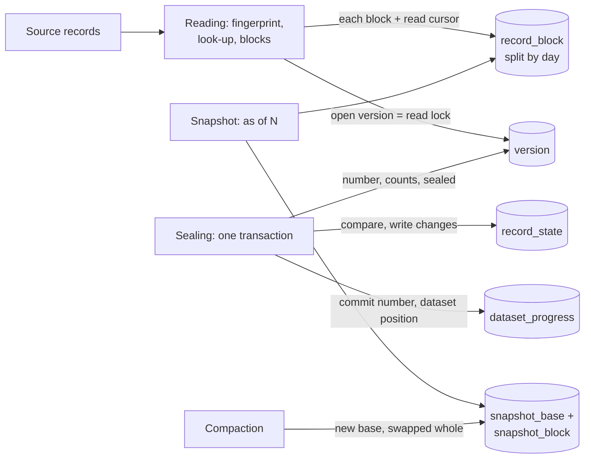

## Context

The product can sign people in and has a store, but nothing that keeps data a flow read. This
change builds the stored half of the data model agreed in issue 31 (build b of four, issue 35):
partitions, sealed versions and their record blocks, record state, commit numbers, positions,
the current-state snapshot, and the locks between them. The contract is issue 31's points 3,
4, 5, 8 and 13 with its three review rounds (later rounds win), and its "Room left for later",
which this build must not close off. The ADRs `adr/0020` to `adr/0024` carry the reasons for the
decisions that are hard to undo. Build a (issue 34, the catalog) runs at the same time: a
dataset and a package version are its tables, `fcon.catalog_entry` and `fcon.package_version`.

## Agreed design (issue 35, owner, 28-Nov-2026)

The issue's summary of the contract, word for word:

1. **Partitions** (point 3): a row per dataset and slice, keyed by typed values with one canonical spelling, with its UTC start and end; business names made from the scheme, with an optional label.
2. **Versions and blocks** (point 4, rounds 1–3): records in Parquet blocks compressed with zstd, in a table split by day; a version's row with its kind (complete, changes-only, starting), counts, package version, position and state (open, sealed, cleaned up, lost, expired); deletes as records; sealing all or nothing; a version with no changes not stored.
3. **Record state** (point 5, rounds 1–3): one row per dataset and key with the fingerprint (over declared fields when a shape is declared), current partition, last-changed version, present or removed; the comparison inside the sealing transaction; unchanged records write nothing; "seen in this run" in a per-run set; a complete read's key list only when needed, as a compact block.
4. **The current-state snapshot** (round 2): a base as of commit number N plus a tail of later versions, read always as of an explicit N; compaction swaps a new base in whole and never takes the sealing lock; a pinned N can't expire.
5. **Commit numbers** (round 3): one sequence per dataset, given at the very end of the sealing transaction under a short dataset-wide lock.
6. **Locks** (rounds 1–3): a read lock for the whole of a batch read of a partition; a sealing lock only during sealing; taken in partition id order.
7. **Positions** (point 8, round 3): a dataset position (per partition only where the connector declares it) moved only in the sealing transaction; a read cursor for an open read, written with each block.
8. **Room for erasure** (point 13): the block format leaves room for fields encrypted per person.

**Added by the owner during the build (28-Nov-2026), part of point 4:** a version's row also
records *records read* (every record the read produced, before comparison) and *unchanged*
(records left out because their fingerprint matched, R3.8), beside added, changed and deleted.
They are counted during sealing; unchanged records still write nothing to record state. They
feed R7.23.

## The speed prototype (Q-02, measured first)

**Question:** rows read per second per worker, source to sealed version, with the state
comparison inside sealing and the commit-number step, against Q-02's 20,000.

**Method:** one worker process, one partition, Postgres 18.7 in the development container
(Docker on WSL 2), Windows 11, 8 logical cores, pyarrow 26. Order-like records of 10 fields
(about 200 bytes as JSON) from memory, so only the hub's own work is timed. Per block of 5,000
rows: canonical form and SHA-256, the read-time look-up of the block's keys in record state,
the changed rows written as one zstd Parquet block (plus a key-list block for complete reads),
the read cursor with the block. Sealing in one transaction: the sealing lock, the candidates
copied into a temporary table and compared with record state, changed rows written, deletes
found, the version numbered, and the commit number given last. The tables had the shapes of
§ Decisions. The machine was shared with other builds the whole time (about 30% of the CPU was
theirs), and runs varied by up to 40%: each figure is the best of the runs.

**Result** (rows read per second, one worker; best of the runs):

| Read | 200,000 rows | 1,000,000 rows |
|---|---|---|
| First complete read, every record new | 32,584 | 29,508 |
| Complete read again, 1% changed | 48,913 | 38,603 |
| Complete read, 1% deleted at the source | 57,475 | 47,804 |
| Change-stamp read, every record changed, one version | 27,047 | 19,147 |
| Look-back re-read, nothing changed | 66,499 | 55,178 |
| Small versions of 50 changed records (events) | 48 ms each | |

Every case reaches 20,000 but one: a change-stamp read of a million changed records sealed as one
version (19,147), where the seal's update of record state took 22 s of the 52. Two changes fix it
(decision 2, a fillfactor of 50, measured four times faster on that update: 5 s for a million rows,
every update HOT), and decision 6's cap on a changes-only version (200,000 changes). The
million-row figure with both is measured again below once the machine is idle.

The machine is a 4-core laptop processor shared with five other sessions and the database's
virtual machine; later runs got as little as a tenth of a core and are not comparable. A worker on
a host of its own does at least as well.

**What the prototype changed in the design:** decisions 2 and 6a below. A first version looked
up a block's keys with a filter on the slice too, and the planner chose the slice's index: a
1%-changed re-read fell to 7,800 rows/s; looking up by key alone fixed it.

## Decisions

The data is built in a new package, `fcon_server.data`, above the store: partitions
(`partitions.py`), fingerprints (`fingerprints.py`), blocks (`blocks.py`), reading
(`reading.py`), sealing (`sealing.py`) and the snapshot (`snapshot.py`). It takes records as
Python dicts; the connector SDK (area 1) will call it.

### 1. The comparison: looked up during the read, decided inside sealing

While reading, each block's keys are looked up in record state (read only, no lock). A record
whose fingerprint and slice match its state is left out of the block and counted unchanged; the
others are *candidates*, written to the block. A key that is already a candidate in this read
stays one for every later copy, so the last copy counts across blocks (R3.22). Inside the
sealing transaction, under the sealing lock, the candidates are compared again with record state
as it is then: only those still different become the version's changes and are written to
record state; an earlier copy of a key, and a candidate that state now matches, are listed in its
block as *left out*. Rejected: writing every record read into blocks and comparing all of them
at sealing (stores unchanged content, against round 1 fix 1, and measured slower); comparing
only during the read (state can change between the read and the seal: events seal into the
same slice meanwhile, and a record can move from another slice).

A record unchanged at read time whose state an event changed before this seal is left out: the
event's newer content stands. Deliberately not handled.

### 2. Record state keeps half of each page free, so its updates write no index entry

`fcon.record_state` is created with `fillfactor = 50`. A seal updates the fingerprint, the
last-changed version and the who-and-when columns, none of them indexed, so Postgres updates the
row in place (a HOT update) instead of adding an entry to each of its three indexes. Measured
on one million rows: 20 s with the default, 5 s at 50 (every update HOT). The table takes about
1.7 times the space. Rejected: the default (a change-stamp read of a million changed rows fell
under 20,000 rows/s); a narrower key without `id` (no faster once updates are HOT, and against
convention 14). Undone by `ALTER TABLE … SET (fillfactor = 100)`, which only affects pages
written later.

### 3. Bulk data rows are written set-based and audited once per version

Record state and blocks are written by set-based SQL inside the sealing transaction, through a
store helper that binds the context's tenant, actor and the clock's time (`tx.stamp()`), never
row by row through `tx.insert`, and with no audit record per row: the seal's audit record is the
version's own (its update to sealed, through `tx.update`, with the counts). Rejected: one audit
record per record (it would double every write, and the audit log keeps every change for good,
against R10.4's purpose of recording who changed what). ADR 0022.

### 4. Blocks: Parquet with zstd, one row each, in a table split by day

`fcon.record_block` is partitioned by range on `created_at`, one partition per UTC day, so build
d drops old days whole. A block holds one Parquet file compressed with zstd: the records'
fields as typed columns, plus the hub's own columns prefixed `_fcon_` (`_fcon_deleted`, and
`_fcon_moved_from` for a record that left another slice). Its key-value metadata says
`fcon.format = 1`; a reader refuses another format. A block row has a `kind`: `records` (content)
or `keys` (a complete read's key list: keys and fingerprints only, written only for complete
reads), its row count and its left-out rows. Room left for later: a `location` column
(`database` now; object storage in M2, R3.16) with `data` empty when the block lives elsewhere;
and a personal field encrypted per person (point 13) is a binary column of the same name whose
field metadata says `fcon.encrypted = person-key`, beside a `_fcon_person` column with the
person's id. Nothing is encrypted in M1. The upgrade makes the day partitions from the clock's
day through 90 days ahead; readiness is not ready when today's is missing, and warns when fewer
than 30 remain (the runbook says to run the upgrade), until build d's retention job makes them
daily. ADRs 0021 (`pyarrow`) and 0023.

Rejected: a row per record (point 4); a block per version (a read of millions would be one huge
value, and resuming would lose the block in progress); a default partition (a day dropped whole
would not cover its rows).

### 5. An open version is the read lock

A batch read starts by inserting its version, state `open`, with a lease (`lease_expires_at`).
A partial unique index allows one open version per partition, so a second read of the same
slice is refused at once, naming the open one. Each block is written in its own short
transaction together with the read cursor and a renewed lease. A read whose worker died is
found by its expired lease: it is resumed from its read cursor by claiming it (`FOR UPDATE SKIP
LOCKED`, convention 13), or cleaned up (`open → cleaned up`, its blocks removed). Rejected: a
session advisory lock (it needs one connection held for the whole read, is lost silently when a
pooled connection is reset, and leaves no row to resume from or to show). Events (build d) seal
in one transaction and never leave a version open, so they never wait behind a batch read.
ADR 0024.

### 6. The sealing lock, then the commit number last

Sealing takes, per partition, a transaction-scoped advisory lock (`pg_advisory_xact_lock` with
a fixed class number for sealing and a hash of the tenant and partition id) in partition id
order, so sealing several slices of one run never deadlocks. Under it: the comparison
(decision 1), the deletes, the version's number in its slice (the partition row's counter), and
the dataset position. The very last statement takes the dataset's row in
`fcon.dataset_progress` (`UPDATE … RETURNING`), giving the next commit number; that row lock is
held only until the commit, so commits become visible in number order and reading as of N never
misses a lower number. Rejected: a Postgres sequence (numbers become visible out of order and
have gaps); numbering at the start of sealing (the dataset-wide lock would be held for the whole
comparison). ADR 0024.

### 6a. A changes-only read seals every 200,000 changes

A changes-only read (a change stamp, events) seals a version each time its candidates reach
200,000, and moves its position with that seal (point 8: data and position move together), then
reads on into a new open version. A seal then holds its sealing lock for a few seconds at most.
A complete read is never cut: its deletes need every key read. Rejected: one version per read
whatever its size (a million changes held the sealing lock for 22 s and missed Q-02). The size
becomes an operator setting with the catalog's settings ("batch sizes", point 2).

### 7. Several slices of one read seal together

`seal` takes every open version of one read (a run's slices, R3.21) and seals them in one
transaction. A complete read's deletes are the present records of its slices whose keys are in
none of its key lists, so a record that moved between two slices of the run is never deleted.
A complete read that returns nothing for a slice is refused unless the dataset allows an empty
slice (R3.9). A version whose added, changed and deleted are all zero is not stored: its row and
blocks are removed in the same transaction, the position still moves, and its counts are logged
and given to the caller.

### 8. A record that moves leaves its old slice in the snapshot only

A record read in another slice than its state's is a change in the new slice's version only
(round 1 fix 5); its block row carries `_fcon_moved_from` with the old partition, and the version
lists the partitions it moved records from. The old slice gets no version. Its snapshot drops
the record from that commit on.

### 9. The snapshot: a base as of N, plus the tail, read as of an explicit N

A partition's base is `fcon.snapshot_base` (its commit number N and state `current` or
`replaced`) with its content in `fcon.snapshot_block`, which is not split by day: a base is kept
while the dataset exists. Reading a partition as of N takes the newest base at or below N, then
applies in commit order the sealed versions of that partition above the base and up to N, and
the moves out of it; the last content per key wins and a delete removes it. A version in that
range that is lost or expired, or a base that is gone, makes the read fail with a message naming
it, never with newer state. Compaction builds a new base as of a sealed commit, in its own
transactions, without the sealing lock, then swaps it in by marking the new base current and
the old one replaced in one short transaction (`row_version` guards a race of two compactions).
A replaced base is removed only when no pin in `fcon.snapshot_pin` needs it. A partition with no
base yet starts from empty at N = 0.

### 10. Partitions: canonical values, UTC bounds, names made when shown

A partition's values are kept as `jsonb` (`{"shop": 12, "day": "2026-10-18"}`) and spelled once
canonically (JSON, keys sorted, no spaces) in a text key unique per dataset. A scheme is a list
of fields, each a plain value, a day or month of a time field in the scheme's time zone, or a
bucket of the key's hash; days and months give the slice's start and end in UTC through
`zoneinfo`, so daylight-saving days are right. The business name is made from the scheme and
values each time it is shown ("Shop 12 · 18 Oct 2026", "Bucket 7 of 32", "All" for a dataset with
no scheme); labels from code are kept as the last ones shown. The scheme comes from the
dataset's definition in the catalog; until the SDK writes it, the caller passes it.

### 11. Fingerprints: SHA-256 of one canonical JSON form

Over the declared fields when the dataset declares a shape, else the whole record: JSON with keys
sorted, no spaces, times as UTC ISO 8601, decimals as their text, `1` and `1.0` distinct.

### 12. A developer's command until the SDK and pages exist

`fcon data read <dataset> <file>` reads a JSON-lines file into a dataset as one read (`--key`,
`--by` for the scheme, `--complete`, `--allow-empty`), `fcon data versions <dataset>` lists the
versions per slice with kind, counts and commit number, and `fcon data record <dataset> <key>
[--as-of N]` follows one record. The dataset is found by its full name in the catalog. The
scenarios use these commands; they are a developer's tool, not the SDK's surface. Decided during
the build, for the owner to confirm.

### Tables

One expand-only migration, in `fcon`, each with `tenant_id` first in its key and every index:

| Table | Key | Rows | What it holds |
|---|---|---|---|
| `partition` | `(tenant_id, id)`, unique `(tenant_id, dataset_id, values_key)` | change | values, start and end, labels, its version counter, its own position when declared |
| `version` | `(tenant_id, id)`, unique open batch read per partition | change | kind, state, number, commit number, counts, package version, shape, read cursor, lease, position, read start, moved-from partitions |
| `record_block` | `(tenant_id, id, created_at)`, by day | added | Parquet, kind, row count, left-out rows, location |
| `record_state` | `(tenant_id, id)`, unique `(tenant_id, dataset_id, key)` | change | key, partition, fingerprint, last-changed version, present |
| `dataset_progress` | `(tenant_id, dataset_id)` | change | last commit number, dataset position |
| `snapshot_base` | `(tenant_id, id)` | change | partition, commit number, state |
| `snapshot_block` | `(tenant_id, id)` | added | Parquet of a base |
| `snapshot_pin` | `(tenant_id, id)` | added | dataset, commit number, who and why |

Foreign keys to `fcon.catalog_entry` and `fcon.package_version` (issue 34) are added by a later
migration once both builds are on `main`; until then the columns are plain ids, and tests use a
stand-in.

## Threats

The change stores source data and adds a command that reads it. Following `security-baseline`:

- **Tenants:** every new table carries the tenant in its key; reads and writes go through the
  store's transaction, which binds it from the context; a test reads another tenant's dataset
  and gets nothing.
- **Personal data in logs:** log lines name datasets, partitions, versions and counts, never a
  record's content or key values.
- **Outside input:** the command reads a file the developer names; a line that is not a JSON
  object is refused with its line number, never parsed as code. Parquet from the database is
  read with pyarrow only; a block of another format is refused.
- **Rights:** the command runs with the database address, as `fcon users` does today; masking
  personal fields when showing records (R1.11) comes with the data pages.

## Risks / Trade-offs

- [Seal time grows with the changes in one read] → the sealing lock is held while a slice's
  changes are written; decision 6a keeps a changes-only seal to 200,000 changes, but a
  complete read of a million new records still holds it about 15 s. Events for that slice wait
  that long (Q-01 allows 30 s); a seal over 10 s logs a warning.
- [Record state takes 1.7 times the space] → measured, and undone by changing the fillfactor.
- [Day partitions made ahead by the upgrade] → readiness warns 30 days before they run out;
  build d's retention job makes them daily.
- [Issue 34 not merged yet] → plain id columns now, constraints later; a stand-in catalog table
  in test fixtures only.

## Migration Plan

One migration that only adds tables; the previous version of the product runs on the new
database unchanged. Nothing to roll back but the tables, which nothing else reads yet.

## Open Questions

None. The decisions taken during the build for the owner to confirm are listed in the PR.
